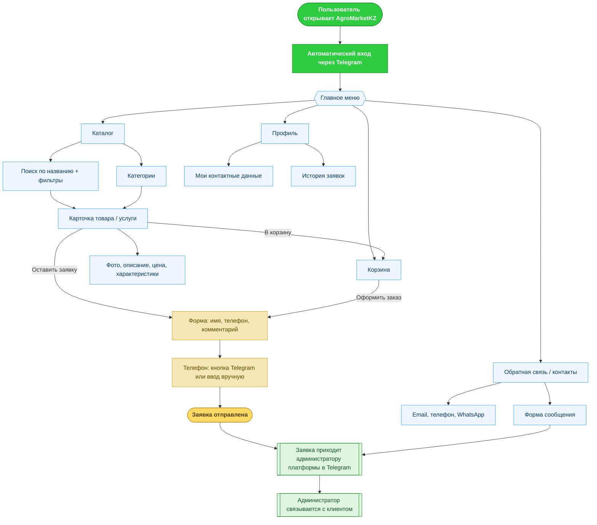

# AgroMarketKZ — Карта пользовательских сценариев

Высокоуровневый путь пользователя в приложении (Telegram Mini App / браузер).

## Ключевые моменты для презентации

- **Вход без регистрации** — пользователь сразу в приложении через Telegram.
- **Два пути оставить заявку**: быстро из карточки или через корзину (несколько позиций).
- **Онлайн-оплаты нет** — любое действие превращается в заявку, которую обрабатывает администратор платформы и связывается с клиентом.
- **Заявка мгновенно** приходит администратору платформы в Telegram и сохраняется для учёта.
