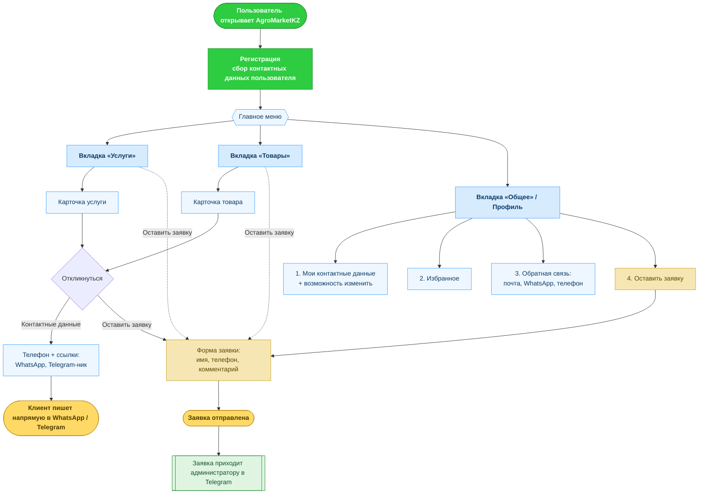

# AgroMarketKZ — Карта пользовательских сценариев

Высокоуровневый путь пользователя в приложении (Telegram Mini App / браузер).

## Ключевые моменты для презентации

- **Регистрация на входе** — при первом входе пользователь проходит регистрацию, чтобы платформа собирала контактные данные тех, кто регистрируется.
- **Нижняя панель из 3 вкладок**: «Услуги», «Товары» и «Общее» (профиль).
- **Отклик на товар/услугу даёт 2 варианта**:
  1. **Контактные данные** — телефон + кликабельные ссылки на WhatsApp и Telegram, чтобы клиент сразу написал.
  2. **Оставить заявку** — форма с именем, телефоном и комментарием.
- **Заявку можно оставить из нескольких мест**: с карточки, прямо с вкладок «Услуги»/«Товары» и из раздела «Общее».
- **Вкладка «Общее»** содержит: (1) мои контактные данные с возможностью изменить, (2) избранное, (3) обратную связь (почта, WhatsApp, телефон), (4) оставить заявку.
- **Онлайн-оплаты нет** — заявка приходит администратору в Telegram, дальше связь напрямую.
