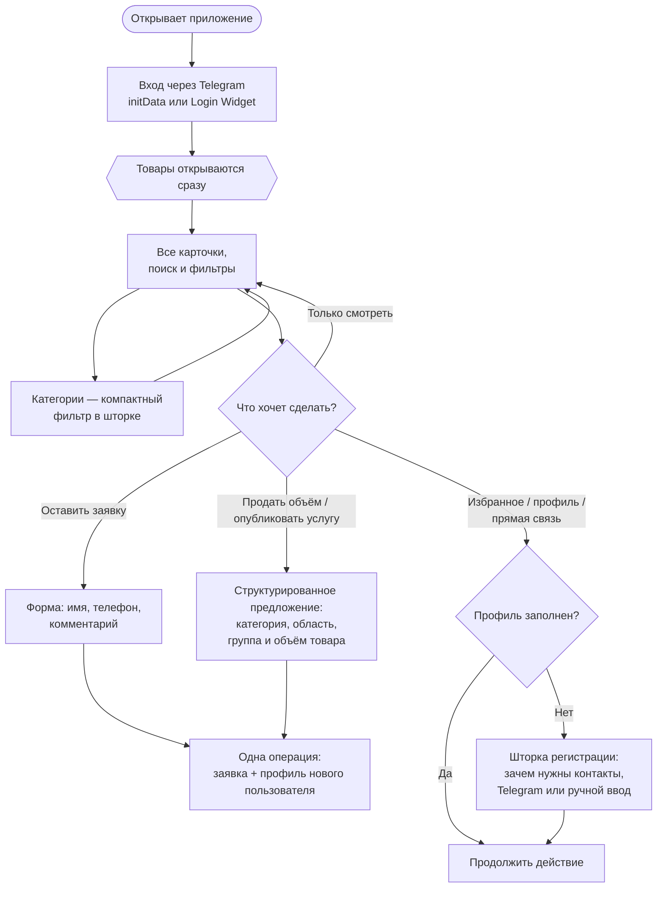
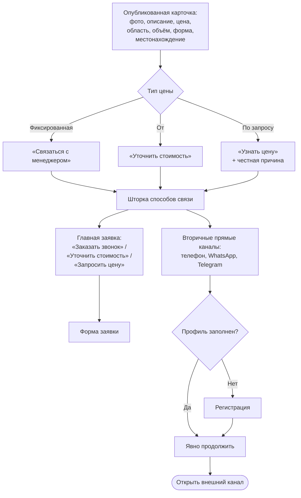
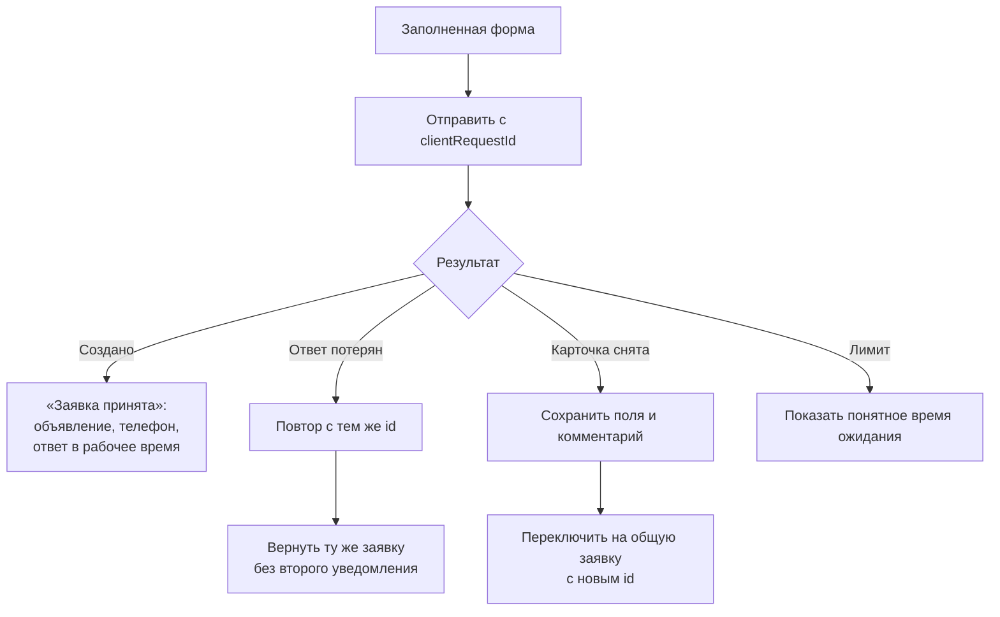
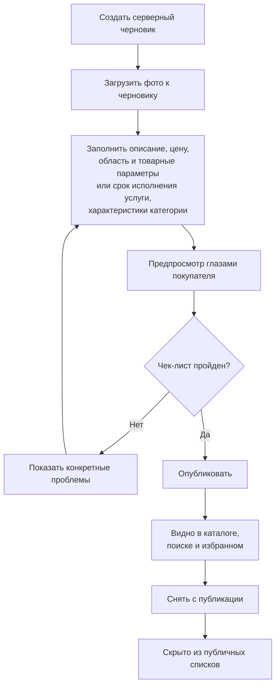

# AgroMarketKZ — Карта пользовательских сценариев

Актуальный высокоуровневый путь пользователя в Telegram Mini App и браузере.

## Вход, каталог и отложенная регистрация

Личность подтверждается через Telegram — отдельного логина и пароля нет. Заполнение имени и телефона больше не является стеной перед каталогом.

- Каталог, поиск и детали опубликованных карточек доступны пользователю с подтверждённой Telegram-личностью без телефона.
- Избранное и личные разделы откладывают исходное действие, открывают регистрацию и автоматически продолжают его после успеха.
- Перед внешним звонком / WhatsApp / Telegram после регистрации требуется второе явное нажатие: приложение не открывает внешний канал автоматически.
- Первая заявка не требует отдельной регистрации. Контакты из неё атомарно создают профиль нового пользователя.
- «Поделиться номером из Telegram» только заполняет и подтверждает номер; окончательная отправка остаётся отдельным явным действием.
- Для товаров одна шторка фильтров и сортировки хранит параметры в URL: область из 17 областей, «На элеваторе»/«С места», группы продукции, формы собственности, сортировка по цене или объёму от меньшего к большему. Для услуг остаётся отдельный фильтр регионов, включая города республиканского значения.

## Карточка и связь

До регистрации API сообщает только доступность каналов, но не раскрывает реальные контакты площадки.

## Отправка и восстановление заявки

- Сервер повторно проверяет доступность карточки в финальной транзакции.
- Повтор с тем же идентификатором и теми же данными возвращает существующую заявку; изменённые данные с тем же идентификатором дают конфликт.
- Только новая заявка отправляет Telegram-уведомление администратору.
- Экран успеха не обещает точный срок, который команда не гарантирует: используется формулировка «в рабочее время».

## Публикация карточки администратором

Публичная видимость едина для всех поверхностей: карточка видна только когда опубликована и не архивирована. Удаление черновика также очищает связанные файлы из Storage.

## Ключевые продуктовые правила

- Нижняя панель содержит «Товары», «Услуги» и «Общее»; незаполненный профиль не мешает изучать каталог.
- Заявка — главное действие в шторке связи, но прямые каналы не скрываются.
- Цена всегда объясняет контекст: фиксированная / «от» / по запросу, единица измерения и при необходимости причина.
- Онлайн-оплаты нет: заявка приходит администратору в Telegram и хранится в админ-панели.
- Нет звука успеха, фальшивой срочности и неподтверждённых обещаний. Анимация учитывает системное ограничение движения, ключевые состояния объявляются скринридеру.
